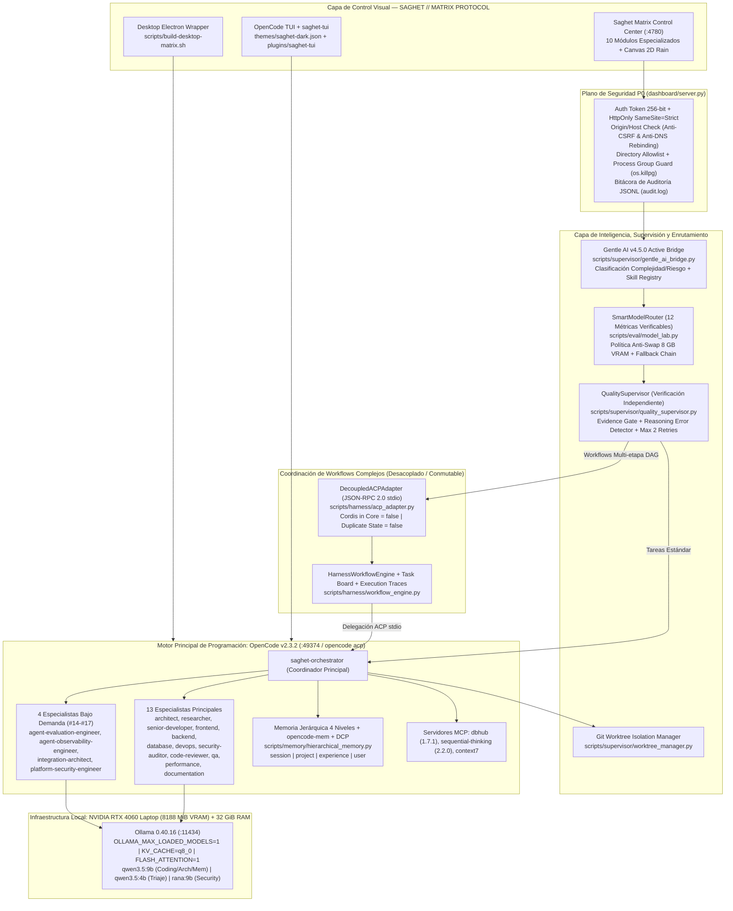

# Arquitectura Técnica — OpenCode-Saghet // MATRIX PROTOCOL (Next-Gen Upgrade)

## 1. Visión General

**OpenCode-Saghet (`v0.2.0-matrix-nextgen`)** es una plataforma avanzada de desarrollo autónomo con IA local-first para **Garuda Linux y Arch Linux**, construida sobre **OpenCode v2.3.2**, **Gentle AI v4.5.0**, **Ollama 0.40.16**, **Saghet Matrix Control Center (10 módulos)** y un **Adaptador Desacoplado DeepSeek Harness vía ACP**, optimizada específicamente para hardware **NVIDIA GeForce RTX 4060 Laptop (8188 MiB VRAM)**, **AMD Ryzen 9 7940HS** y **32 GiB RAM**.

---

## 2. Diagrama de Arquitectura Integral (Next-Gen)



---

## 3. Estructura del Repositorio

```text
OpenCode-Saghet/
├── compatibility.json                        # Matriz de versiones, hardware y componentes fijados
├── LICENSE / NOTICE.md                       # Licencias y atribuciones upstream (MIT / Apache-2.0)
├── install.sh / update.sh / doctor.sh        # Ciclo de vida idempotente para Garuda / Arch Linux
├── restore.sh / uninstall.sh                 # Restauración desde snapshots y desinstalación limpia
├── config/
│   ├── opencode.json.tpl                     # 17 especialistas, modelos, MCP y permisos endurecidos
│   ├── AGENTS.md                             # Contrato operativo multiagente y Supervisor de Calidad
│   ├── dcp.jsonc                             # Dynamic Context Pruning (protectUserMessages: true)
│   ├── opencode-mem.jsonc                    # Memoria local alineada en VRAM con qwen3.5:9b
│   ├── harness.json                          # Configuración declarativa y toggle de DeepSeek Harness ACP
│   ├── ollama-override.conf                  # OLLAMA_MAX_LOADED_MODELS=1, FLASH_ATTENTION=1, KV=q8_0
│   ├── saghet-dashboard.service.tpl          # Unidad systemd --user para Saghet Control Center
│   ├── dbhub.toml.tpl                        # Fuentes SQLite/PostgreSQL con límites RO/RW
│   └── tui.json                              # Tema saghet-dark y plugin TUI
├── commands/                                 # Comandos slash sincronizados con saghet-orchestrator
│   ├── judgment-day.md
│   ├── skill-creator.md
│   ├── skill-registry.md
│   └── supervisor-audit.md
├── skills/                                   # Skills reutilizables versionadas
│   ├── db-safe-ops/SKILL.md
│   ├── multiagent-workflow/SKILL.md
│   ├── security-checklist/SKILL.md
│   └── worktree-isolation/SKILL.md
├── scripts/
│   ├── opencode-saghet                       # Lanzador CLI + Control Center + Desktop Wrapper
│   ├── build-desktop-matrix.sh               # Wrapper Electron Matrix sin tocar app.asar
│   ├── supervisor/                           # Fase 2: Supervisión Inteligente y Gentle AI
│   │   ├── gentle_ai_bridge.py
│   │   ├── quality_supervisor.py
│   │   └── worktree_manager.py
│   ├── eval/                                 # Fase 3: Laboratorio de Evaluación y SmartModelRouter
│   │   └── model_lab.py
│   ├── memory/                               # Fase 4: Memoria Jerárquica (4 niveles)
│   │   └── hierarchical_memory.py
│   ├── harness/                              # Fase 5: Adaptador Desacoplado DeepSeek Harness ACP
│   │   ├── acp_adapter.py
│   │   └── workflow_engine.py
│   └── telemetry/
│       └── gpu-ollama-bench.py
├── dashboard/                                # Fase 6 & 7: Saghet Matrix Control Center (10 módulos)
│   ├── server.py                             # Backend blindado P0 + SQLite RO (< 40 ms)
│   ├── index.html                            # 10 módulos visuales Matrix Protocol
│   ├── app.js                                # Lógica cliente autenticada (X-Saghet-Token)
│   ├── matrix-rain.js                        # Motor Canvas 2D eficiente
│   └── styles.css                            # Sistema de diseño Matrix Protocol
├── benchmarks/
│   ├── rtx4060_saghet.json                   # Línea base tok/s, TTFT y VRAM en RTX 4060
│   ├── model_evaluation_matrix.json          # Matriz comparativa de 12 métricas y scoring por especialidad
│   ├── saghet_intelligence_benchmarks.json   # Resultados verificados de los 10 benchmarks reales (10/10)
│   └── matrix_ui_perf.json                   # Rendimiento de renderizado UI
├── tests/
│   ├── run_acceptance.py                     # Suite de aceptación integral (14 categorías A-N)
│   └── benchmarks/
│       └── run_intelligence_benchmarks.py    # Laboratorio reproducible de 10 escenarios aislados
└── docs/
    ├── ARCHITECTURE.md
    ├── VISUAL_ARCHITECTURE.md
    ├── FEATURE_MATRIX.md
    ├── EXTENSIONS_INVENTORY.md
    ├── INSTALLATION_AND_CONFIG_MANUAL.md
    ├── UPGRADE_AND_MAINTENANCE_GUIDE.md
    ├── SECURITY_AND_BENCHMARK_REPORT.md
    └── adr/                                  # Architecture Decision Records (ADR-001 a ADR-005)
```

---

## 4. Equipo de 17 Especialistas (13 Principales + 4 Bajo Demanda)

| # | Agente | Tipo | Modelo Asignado | Permisos | Responsabilidad |
| :-: | :--- | :---: | :--- | :---: | :--- |
| 1 | `saghet-orchestrator` | Principal (`primary`) | `ollama/qwen3.5:9b` | Completo (con guardrails) | Coordinación A–F, enrutamiento Gentle AI y Supervisor de Calidad |
| 2 | `architect` | Principal (`subagent`) | `ollama/qwen3.5:9b` | Solo lectura | Arquitectura modular, contratos y ADRs |
| 3 | `researcher` | Principal (`subagent`) | `ollama/qwen3.5:9b` | Solo lectura + `context7` | Investigación técnica, GitHub y documentación oficial |
| 4 | `senior-developer` | Principal (`subagent`) | `ollama/qwen3.5:9b` | R/W/Bash | Implementación general, refactorización y corrección de bugs |
| 5 | `frontend-specialist` | Principal (`subagent`) | `ollama/qwen3.5:9b` | R/W/Bash | Interfaz, UX, HTML/CSS/TS y accesibilidad |
| 6 | `backend-specialist` | Principal (`subagent`) | `ollama/qwen3.5:9b` | R/W/Bash | APIs, servicios, seguridad HTTP y concurrencia |
| 7 | `database-specialist` | Principal (`subagent`) | `ollama/qwen3.5:9b` | R/W/Bash + `dbhub` | Persistencia SQLite/PostgreSQL/Redis, esquemas y `EXPLAIN` |
| 8 | `devops-engineer` | Principal (`subagent`) | `ollama/qwen3.5:9b` | R/W/Bash | Garuda/Arch Linux, `systemd`, Docker, `git worktree` e instaladores |
| 9 | `security-auditor` | Principal (`subagent`) | `ollama/abliterant/qwen3.5-rana:9b` | Solo lectura | Auditoría de vulnerabilidades, permisos, secretos y prompt injection |
| 10 | `code-reviewer` | Principal (`subagent`) | `ollama/qwen3.5:9b` | Solo lectura | Revisión independiente de diffs, regresiones y criterios |
| 11 | `qa-engineer` | Principal (`subagent`) | `ollama/qwen3.5:9b` | R/W/Bash | Pruebas funcionales, unitarias, integración y regresión real |
| 12 | `performance-engineer` | Principal (`subagent`) | `ollama/qwen3.5:9b` | R/W/Bash | GPU, VRAM CUDA, RAM, `tok/s`, TTFT y latencia |
| 13 | `documentation-engineer` | Principal (`subagent`) | `ollama/qwen3.5:9b` | R/W (sin Bash) | Manuales, diagramas Mermaid y ADRs verificados |
| 14 | `agent-evaluation-engineer` | Bajo demanda (`subagent`) | `ollama/qwen3.5:9b` | R/W/Bash | Evaluación cuantitativa de modelos (12 métricas) y benchmarks |
| 15 | `agent-observability-engineer` | Bajo demanda (`subagent`) | `ollama/qwen3.5:9b` | Solo lectura | Trazas de ejecución, detección de bucles y errores de razonamiento |
| 16 | `integration-architect` | Bajo demanda (`subagent`) | `ollama/qwen3.5:9b` | Solo lectura | Contratos ACP, DeepSeek Harness, Gentle AI, MCP y plugins |
| 17 | `platform-security-engineer` | Bajo demanda (`subagent`) | `ollama/abliterant/qwen3.5-rana:9b` | Solo lectura | Blindaje de APIs locales, CSRF/DNS Rebinding, `systemd` y worktrees |
