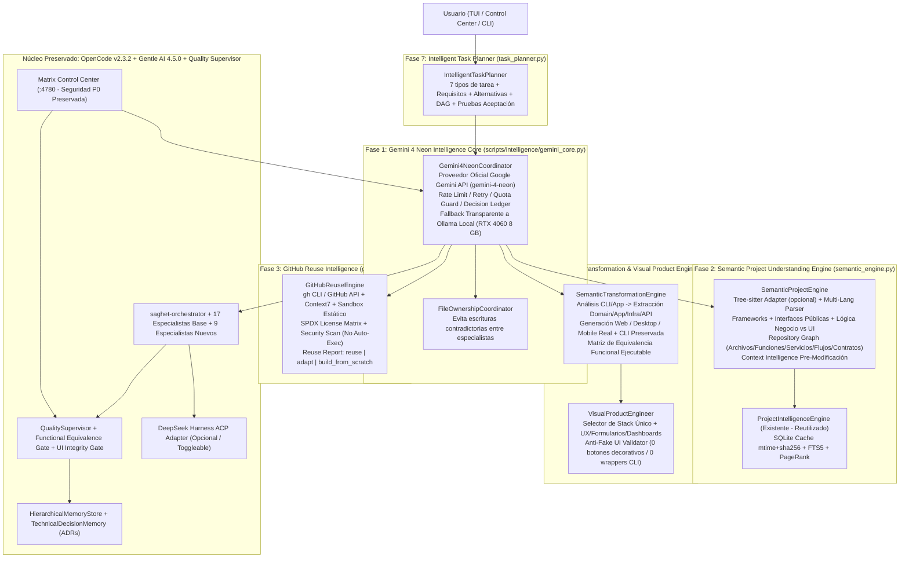

# Auditoría Técnica y Arquitectura Propuesta — Saghet Intelligent Engineering Architecture (`v0.5.0-gemini4-neon`)

> **Fecha de auditoría:** 2026-11-22  
> **Repositorio auditado:** `OpenCode-Saghet` (`HEAD c15862a`, tag `v0.4.0-cognitive-evolution-v3` + cambios locales de Fase 3/4 `phase_ledger.py` y allowlist `permission.task`)  
> **Hardware verificado:** Garuda Linux (`7.3.5-zen1-1-zen`), NVIDIA RTX 4060 Laptop (8188 MiB VRAM), 32 GiB RAM, Python 3.14.10, Node v26.13.1, OpenCode v2.3.2, Ollama 0.40.16, GitHub CLI (`gh` autenticado).

---

## 1. Inventario de Auditoría (Fase 0)

### 1.1 Funcionalidades Existentes y Verificadas (No Reconstruir)

| Componente | Evidencia en Código | Estado Verificado |
| :--- | :--- | :--- |
| **Motor OpenCode v2.3.2 + 17 Especialistas** | [config/opencode.json.tpl](../config/opencode.json.tpl) | 17 especialistas + `plan` + `fast-helper`, `subagent: false` en todos los subagentes, `permission.task` allowlist estricta, bloqueo de secretos (`.env*`, `*.key`, `service.json`). |
| **Gentle AI v4.5.0 Active Bridge** | [scripts/supervisor/gentle_ai_bridge.py](../scripts/supervisor/gentle_ai_bridge.py) | `IntentUnderstandingEngine`, `classify_and_route`, `build_adaptive_reasoning_plan`, `get_gentle_ai_status`, `refresh_gentle_ai_skills`. |
| **Quality Supervisor & Independent Review 2.0** | [scripts/supervisor/quality_supervisor.py](../scripts/supervisor/quality_supervisor.py) | `QualitySupervisor`, `TaskDependencyDAG`, 14 clases de error, Gate Creador–Verificador, `run_independent_review()`, ledger JSONL `0600`. |
| **SmartModelRouter & Model Lab** | [scripts/eval/model_lab.py](../scripts/eval/model_lab.py), [benchmarks/model_evaluation_matrix.json](../benchmarks/model_evaluation_matrix.json) | 12 métricas verificables, política anti-swap RTX 4060 8 GB VRAM (`OLLAMA_MAX_LOADED_MODELS=1`), ajuste histórico con `outcome_records`. |
| **Memoria Jerárquica + User/Outcome/Experiments/PhaseLedger** | [scripts/memory/hierarchical_memory.py](../scripts/memory/hierarchical_memory.py), [user_intelligence.py](../scripts/memory/user_intelligence.py), [outcome_learning.py](../scripts/memory/outcome_learning.py), [experiment_registry.py](../scripts/memory/experiment_registry.py), [phase_ledger.py](../scripts/memory/phase_ledger.py) | 4 niveles (`session`, `project`, `experience`, `user`), FTS5 BM25 + embeddings locales/Ollama, escudo contra prompt injection y secretos, resolución de contradicciones, experimentos con gate de seguridad. |
| **Project Intelligence Engine V3** | [scripts/memory/project_intelligence.py](../scripts/memory/project_intelligence.py) | Caché incremental SQLite (`mtime_ns` + `sha256`), parser `.gitignore`, AST Python, regex JS/TS/Rust/Go/Bash, PageRank `build_repo_map()`, detección de ciclos y duplicados, búsqueda híbrida FTS5. |
| **DeepSeek Harness ACP Adapter (Opcional)** | [scripts/harness/acp_adapter.py](../scripts/harness/acp_adapter.py), [workflow_engine.py](../scripts/harness/workflow_engine.py) | JSON-RPC 2.0 stdio, DAG con `_gpu_lock`, Task Board, Execution Traces append-only, toggleable (`cordis_in_core=False`). |
| **Matrix Control Center (Blindado P0)** | [dashboard/server.py](../dashboard/server.py), [index.html](../dashboard/index.html), [app.js](../dashboard/app.js) | Token 256-bit, cookie `HttpOnly; SameSite=Strict`, Anti-CSRF/DNS Rebinding (`Origin`/`Host`), allowlist de directorios, `os.killpg`, `audit.log`, 10 módulos visuales. |
| **Session Diagnostics Engine** | [scripts/supervisor/session_diagnostics.py](../scripts/supervisor/session_diagnostics.py) | Auditoría solo lectura de `opencode.db`, sockets `:11434`, compactaciones, amnesia, truncamientos y agentes legacy. |
| **Línea Base de Pruebas Automatizadas** | `tests/test_phase*.py`, `tests/run_acceptance.py`, `tests/benchmarks/run_cognitive_benchmarks.py` | **35/35** unit tests OK (0.57s), **15/15** acceptance tests OK (9.49s), **20/20** cognitive benchmarks OK (230.8 ms). |

### 1.2 Funcionalidades Parcialmente Implementadas (Ampliar sin Romper)

1. **Proveedores de modelos (`config/opencode.json.tpl` y `SmartModelRouter`)**: Solo declara `ollama`; no incluye el proveedor oficial `google` (`@ai-sdk/google`) ni el modelo verificado `gemini-4-neon`, ni manejo de cuotas/reintentos/rate-limits de API cloud ni coordinación híbrida Gemini 4 Neon + ejecutores locales Ollama.
2. **Comprensión de proyectos (`project_intelligence.py`)**: Excelente caché incremental SQLite y AST Python, pero carece de detección de frameworks/lenguajes completa, clasificación de capa funcional (lógica de negocio vs interfaz CLI/UI), contratos de interfaces públicas, servicios/entradas/salidas, adaptador Tree-sitter opcional y recuperación pre-modificación con consumidores y ADRs estructurados.
3. **Planificación (`gentle_ai_bridge.py` / `quality_supervisor.py`)**: Clasifica 5 tipos básicos de tarea (`research|coding|debugging|architecture|other`); no distingue las 7 categorías de ingeniería (`new_development`, `refactoring`, `migration`, `interface_transformation`, `integration`, `repair`, `research`) ni genera planes verificables con tecnologías seleccionadas, componentes reutilizables, conflictos de archivo y pruebas de aceptación.
4. **Memoria de decisiones técnicas (`hierarchical_memory.py`)**: Almacena `architectural_decision` en texto libre, sin esquema estructurado obligatorio (problema, alternativas evaluadas, decisión, justificación, consecuencias, fecha, proyecto).
5. **Validación funcional (`quality_supervisor.py`)**: Verifica diffs, tests y seguridad, pero no incluye verificación de **equivalencia funcional** (CLI original vs Web/Desktop) ni validación anti-UI falsa (botones decorativos, mocks presentados como reales, wrappers que imprimen comandos de terminal).

### 1.3 Funcionalidades Inexistentes (A Construir en `scripts/intelligence/`)

1. **Gemini 4 Neon Intelligence Core** (`scripts/intelligence/gemini_core.py`).
2. **Semantic Project Understanding Engine** (`scripts/intelligence/semantic_engine.py`, extendiendo `ProjectIntelligenceEngine`).
3. **GitHub Reuse Intelligence Engine** (`scripts/intelligence/github_reuse.py`).
4. **Semantic Project Transformation Engine** (`scripts/intelligence/transformation_engine.py`).
5. **Visual Product Engineering & Anti-Fake UI Validator** (`scripts/intelligence/visual_product.py`).
6. **Intelligent Task Planner** (`scripts/intelligence/task_planner.py`).
7. **9 Especialistas faltantes** en `config/opencode.json.tpl`, `permission.task`, `KNOWN_AGENT_NAMES` y `gentle_ai_bridge.py` (sin duplicar los 17 existentes).
8. **Laboratorio reproducible de 10 Benchmarks de Ingeniería (Pruebas A–J)** (`tests/benchmarks/run_engineering_benchmarks.py`).

### 1.4 Problemas Arquitectónicos y Entorno Detectados

- **`GEMINI_API_KEY` no configurada actualmente en el entorno local** (`opencode auth list` reporta `No authenticated integrations`): El núcleo Gemini 4 Neon debe verificar disponibilidad real en tiempo de ejecución (`GET /v1beta/models`), soportar `GEMINI_API_KEY` / `GOOGLE_GENERATIVE_AI_API_KEY` / `opencode auth login`, y degradar explícita y limpiamente a Ollama local sin simular respuestas cloud.
- **`tree_sitter` no instalado en el Python del sistema (3.14.10)**: En Arch/Garuda Python 3.14 sin `pip`, el motor semántico debe usar un adaptador Tree-sitter **activable automáticamente si `tree_sitter` está instalado**, combinado con AST nativo de Python + analizadores estructurales balanceados por llaves/AST para JS/TS/Rust/Go/Shell/HTML/JSON/TOML para funcionar con 0 dependencias obligatorias y sin romper el instalador.
- **Riesgo de concurrencia en edición de archivos**: Al ampliar de 17 a 26 especialistas, múltiples agentes podrían competir por los mismos archivos si se lanzan en paralelo. Se introduce un `FileOwnershipCoordinator` (bloqueo de archivos por tarea en el coordinador Gemini y en el planificador DAG).
- **Código externo de GitHub como contenido no confiable**: Cualquier repositorio inspeccionado por GitHub Reuse Intelligence se analiza únicamente de forma estática en un sandbox temporal aislado, escaneando patrones peligrosos (`eval`, `exec`, `curl|sh`, `subprocess`, prompt injection) y **jamás ejecutando scripts de instalación o hooks del repo externo**.

---

## 2. Diagrama de Arquitectura Propuesta (`v0.5.0-gemini4-neon`)

---

## 3. Plan de Implementación por Etapas Controladas

| Etapa | Alcance | Entregables Principales | Verificación Obligatoria |
| :---: | :--- | :--- | :--- |
| **1** | Auditoría y Arquitectura | `AUDIT_AND_EVOLUTION_V5.md`, `ADR-008`, `ADR-009`, `ADR-010` | Inventario verificado + baseline 35+15+20 tests |
| **2** | Gemini 4 Neon Intelligence Core | `scripts/intelligence/gemini_core.py`, proveedor `google` en `opencode.json.tpl`, extensión `SmartModelRouter` | Pruebas unitarias de API contract, retries, cuota, selección de contexto, fallback Ollama y lock de archivos |
| **3** | Semantic Project Understanding Engine | `scripts/intelligence/semantic_engine.py` sobre `ProjectIntelligenceEngine` | Pruebas de lenguajes/frameworks, Repo Graph completo, capas de negocio vs UI, caché incremental y Context Intelligence |
| **4** | GitHub Reuse Intelligence | `scripts/intelligence/github_reuse.py` | Pruebas de búsqueda GitHub real/offline, inspección estática segura (0 ejecución), matriz SPDX y Reuse Report |
| **5** | Semantic Transformation + Visual Product | `scripts/intelligence/transformation_engine.py`, `visual_product.py`, `task_planner.py` | Transformación real CLI->Web y CLI->Desktop ejecutables + validación Anti-Fake UI + Matriz de Equivalencia |
| **6** | 9 Especialistas + Supervisor + Memoria ADR | `config/opencode.json.tpl`, `AGENTS.md`, `gentle_ai_bridge.py`, `quality_supervisor.py`, `hierarchical_memory.py`, `session_diagnostics.py`, `dashboard/server.py` | Zero duplicaciones, `subagent: false`, `permission.task`, ADR memory, Equivalence Gate |
| **7** | Laboratorio de Benchmarks A–J | `tests/benchmarks/run_engineering_benchmarks.py` -> `benchmarks/saghet_engineering_benchmarks.json` | 10/10 benchmarks reales reproducibles con métricas antes/después sin fabricación |
| **8** | Documentación, Instalador y Cierre | `install.sh`, `doctor.sh`, `compatibility.json`, `FEATURE_MATRIX.md`, `ARCHITECTURE.md`, `CHANGELOG.md` | Suite completa (unit + acceptance + cognitive + engineering benchmarks + `doctor.sh`) |
